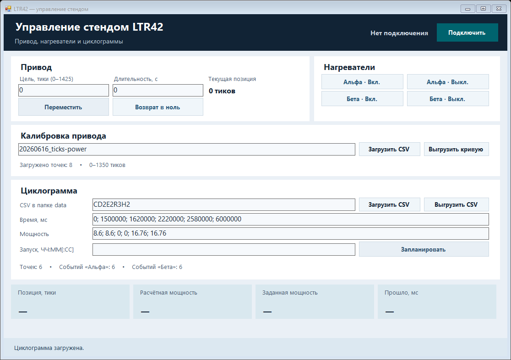

# LTR42_wf

Windows-приложение для управления испытательным стендом через модуль цифрового ввода-вывода LTR42 от «Л Кард». Оператор может перемещать шаговый привод, управлять двумя выходами «Альфа» и «Бета» и запускать по расписанию циклограммы из CSV.



## Возможности

- Ручное перемещение привода к заданной позиции и возврат в ноль.
- Загрузка калибровки «позиция — мощность» и выгрузка рассчитанной кривой с шагом 25 тиков.
- Редактирование профиля мощности, загрузка событий нагревателей и запуск циклограммы по местному времени.
- Отображение расчётной позиции, заданной и расчётной мощности, времени работы и ошибок модуля.

## Сборка и запуск

Понадобятся Windows, Visual Studio 2022 с компонентами **Разработка классических приложений на C++** и **Поддержка C++/CLI для v143**, а также targeting pack для **.NET Framework 4.7.2**.

Установите LTR SDK для Windows. Проект ищет SDK в `C:\Program Files (x86)\L-Card\ltr`. Для другого расположения укажите свойство MSBuild `LtrSdkDir`. [ПО и документация «Л Кард»](https://www.lcard.ru/download/)

1. Откройте [`LTR42_wf.sln`](LTR42_wf.sln) в Visual Studio.
2. Выберите `Release | x64` и соберите решение. Поддерживаются также `Debug` и платформа `x86`.
3. Убедитесь, что библиотеки SDK соответствующей разрядности доступны через `PATH` или лежат рядом с `LTR42_wf.exe`, и запустите приложение.

Из консоли **Developer PowerShell for VS 2022** можно собрать так.

```powershell
msbuild .\LTR42_wf.sln /p:Configuration=Release /p:Platform=x64 /p:PreferredToolArchitecture=x64
```

Файл сборки `Release | x64` находится в `x64\Release\LTR42_wf.exe`. Загрузка и выгрузка CSV доступны без подключения к стенду. Для управления оборудованием подключите крейт и нажмите **Подключить**. При успешном подключении приложение включает выход «Бета».

## Форматы CSV

В окне указывается имя файла из папки [`data`](data). Файлы читаются без строки заголовков, поля разделяются точкой с запятой.

| Файл | Порядок полей |
| --- | --- |
| Калибровка | `позиция_в_тиках;мощность` |
| Циклограмма | `время_мощности_мс;мощность;время_Альфа_мс;Альфа;время_Бета_мс;Бета` |

- Для калибровки нужны минимум три точки со строго возрастающими позициями и значениями мощности. [Пример калибровки](data/20260316_ticks-power.csv)
- Для циклограммы нужны минимум две точки мощности со строго возрастающим временем. Пары полей для нагревателей необязательны. Время событий нагревателей отсчитывается от запуска циклограммы, состояние `0` означает выключение, `1` — включение. [Пример циклограммы](data/CD2E2R3H2.csv)
- Кнопка **Выгрузить кривую** сохраняет `data/calibration_curve.csv`. Кнопка **Выгрузить CSV** в панели циклограммы сохраняет только время и мощность в `data/<имя_калибровки>_cycle.csv`.

## Структура проекта

| Файл | Назначение |
| --- | --- |
| [`MyForm.Layout.cpp`](MyForm.Layout.cpp) | Компоновка и оформление окна |
| [`MyForm.cpp`](MyForm.cpp) | Состояние приложения, таймеры и выполнение циклограммы |
| [`MyForm.Data.cpp`](MyForm.Data.cpp), [`CycleData.h`](CycleData.h) | Чтение и выгрузка CSV, интерполяция и события нагревателей |
| [`LinearInterpolation.h`](LinearInterpolation.h) | Кусочно-линейная интерполяция калибровки в обоих направлениях |
| [`Source.cpp`](Source.cpp), [`Device.h`](Device.h) | Подключение к LTR42 и команды цифровому выходу |

При сообщении об ошибке укажите конфигурацию сборки, версию LTR SDK и шаги воспроизведения. Журнал приложения записывается в папку `logs` рядом с исполняемым файлом. [Сообщить об ошибке](https://github.com/MMaxs-cloud/LTR42_wf/issues/new)
